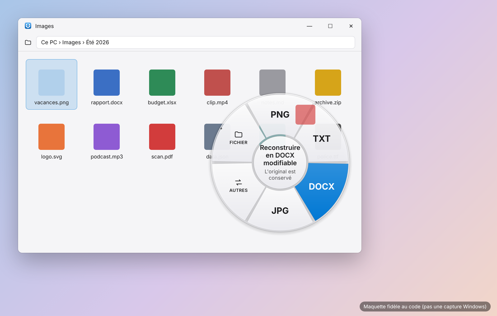

# FileWheel

An action wheel that appears **while you drag a file** in Windows File Explorer or on the Desktop. Hold **Alt** during the drag, then drop the file on a format (**DOCX, JPG, PNG, MP3…**: converted right away, next to the original) or on a tool (**crop, add a background, compress, annotate / redact, metadata** for images). Copy, move, rename, Recycle Bin… live in the "Fichier" (File) sector. Dropping the file anywhere other than the wheel performs the usual Windows drop: FileWheel never breaks native drag and drop.

- Universal, modular converter: documents, images, audio, video, archives, e-books, data, 3D, fonts, e-mails/contacts/calendars (exact list, generated from the code: [docs/CONVERSIONS.md](docs/CONVERSIONS.md)).
- Local by default: no file is ever sent over the Internet. Originals are never modified or overwritten.
- External engines (FFmpeg, ImageMagick, 7-Zip, PDFium, LibreOffice, Calibre) are installed **only with your consent**, downloaded from their official source and verified (SHA-256 hash).
- Hybrid Windows 11 + macOS design, automatic light/dark mode ([docs/DESIGN.md](docs/DESIGN.md)).

> The application's user interface is in French.

  
  

Rendering mockups faithful to the code (not Windows screenshots).

## Download

The latest version is in the **[Releases](https://github.com/nabeiroriviereadriano-design/FileWheel/releases)**: download `FileWheel-Setup-<version>.exe` and run it. The installer is built automatically by GitHub Actions from this repository.

Windows SmartScreen may show "Windows protected your PC": the installer is not code-signed (a signing certificate costs money). Click *More info › Run anyway*, or build it yourself (below).

## Install, update, uninstall: a single .exe

**`FileWheel-Setup-0.2.0.exe`** installs FileWheel for your user account (no administrator rights), **updates** it if an older version is present (settings, history and engines are kept), and offers **Repair / Uninstall** if the same version is already installed. FileWheel appears in the Start menu and in *Windows Settings › Apps*. No .NET runtime to install: the program is self-contained (Windows 10/11 64-bit).

To build this .exe from source (on a Windows PC with Internet access):
1. Clone the repository (`git clone https://github.com/nabeiroriviereadriano-design/FileWheel.git`) or download it as a ZIP (*Code › Download ZIP*) and extract it.
2. Double-click **`INSTALL.bat`**: it compiles FileWheel, creates `FileWheel-Setup-<version>.exe` and runs it. The .NET 10 SDK and NSIS (a free installer builder) are offered through winget if they are missing.
   `BUILD-SETUP.bat` does the same without running the installer (to copy the .exe to another PC).

Important: run FileWheel **without** "Run as administrator". Windows does not let an elevated application receive files dragged from File Explorer.

**Uninstall**: *Windows Settings › Apps › FileWheel › Uninstall*, or run `FileWheel-Setup` again › Uninstall, or `UNINSTALL.bat`. The program, auto-start, shortcuts and downloaded engines are removed; your settings are only deleted if you tick the box. Your files are never touched.

## Documentation

| Document | Contents |
|---|---|
| [docs/USER-GUIDE.md](docs/USER-GUIDE.md) | Using the wheel, the converter and the settings |
| [docs/CONVERSIONS.md](docs/CONVERSIONS.md) | Conversions actually supported (generated from the code) |
| [docs/LIMITATIONS.md](docs/LIMITATIONS.md) | Known limitations: what is not done, and why |
| [docs/SECURITY.md](docs/SECURITY.md) | Security rules applied |
| [docs/DESIGN.md](docs/DESIGN.md) | Hybrid Windows 11 + macOS design system |
| [docs/DEVELOPER.md](docs/DEVELOPER.md) | Architecture, source tree, building, tests |
| [docs/CHANGELOG.md](docs/CHANGELOG.md) | Development milestones (feasibility → delivery) and versions |
| [docs/TEST-RESULTS.md](docs/TEST-RESULTS.md) | Results of the latest test run |
| [docs/WINDOWS-CHECKLIST.md](docs/WINDOWS-CHECKLIST.md) | Checklist to run through on a Windows PC |
| [docs/LICENSES.md](docs/LICENSES.md) | License of FileWheel and of the external engines |

## Contributing

Contributions are welcome: bug reports, ideas and fixes through *Issues* and *Pull requests*. See [CONTRIBUTING.md](CONTRIBUTING.md). In short: logic goes into `FileWheel.Core` / `FileWheel.Conversion` with a test, Windows interop into `FileWheel.Windows`, and a conversion is never advertised unless it is really implemented.

## License

FileWheel code: MIT ([LICENSE.txt](LICENSE.txt)). No third-party engine is included in the repository or in the installer; each keeps its own license ([docs/LICENSES.md](docs/LICENSES.md)).
