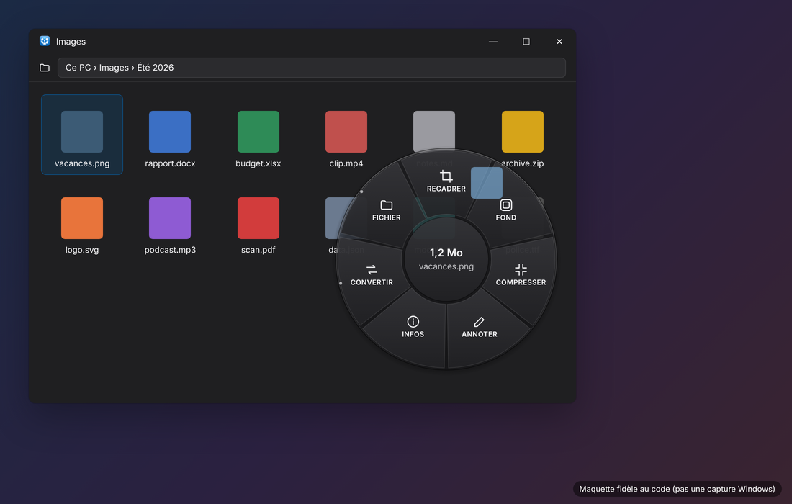
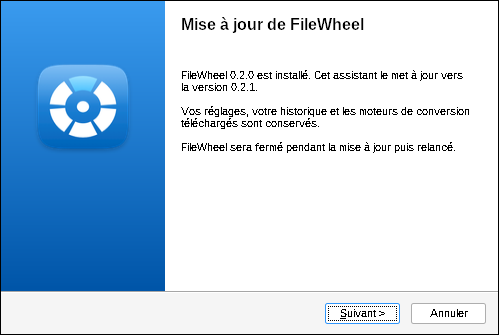

# FileWheel

> **EN —** FileWheel is an open-source Windows tray app: hold **Alt** while dragging a file in Explorer and a radial wheel pops up under the cursor. Drop the file on a format (PDF → DOCX, PNG → JPG, MP4 → MP3…) to convert it next to the original, or on a tool (crop, background, compress, annotate, metadata). Dropping anywhere else is a normal Windows drop — native drag & drop is never broken. Local-only, originals never overwritten, one setup `.exe` to install, update and uninstall. The UI and docs are in French.

Une roue d'actions qui apparaît **pendant que vous faites glisser un fichier** dans l'Explorateur Windows ou sur le Bureau : maintenez **Alt** pendant le glisser, puis déposez le fichier sur un format (**DOCX, JPG, PNG, MP3…** : converti aussitôt, à côté de l'original) ou sur un outil (**recadrer, ajouter un fond, compresser, annoter / masquer, métadonnées** pour les images). Copier, déplacer, renommer, corbeille… sont dans le secteur « Fichier ». Lâcher le fichier ailleurs que sur la roue fait le dépôt Windows habituel : FileWheel ne casse jamais le glisser-déposer natif.

- Convertisseur universel modulaire : documents, images, audio, vidéo, archives, livres numériques, données, 3D, polices, e-mails/contacts/agendas (liste exacte et générée : [docs/CONVERSIONS.md](docs/CONVERSIONS.md)).
- Local par défaut : aucun fichier n'est envoyé sur Internet. Les originaux ne sont jamais modifiés ni écrasés.
- Moteurs externes (FFmpeg, ImageMagick, 7-Zip, PDFium, LibreOffice, Calibre) installés **seulement avec votre accord**, téléchargés depuis leur source officielle et vérifiés (empreinte SHA-256).
- Charte graphique hybride Windows 11 + macOS, clair/sombre automatique ([docs/CHARTE-GRAPHIQUE.md](docs/CHARTE-GRAPHIQUE.md)).

  
  

Maquettes de rendu fidèles au code (pas des captures Windows).

## Télécharger

La dernière version se trouve dans les **[Releases](https://github.com/nabeiroriviereadriano-design/FileWheel/releases)** : téléchargez `FileWheel-Setup-<version>.exe` et lancez-le. L'installateur est compilé automatiquement par GitHub Actions à partir de ce dépôt.

Windows SmartScreen peut afficher « Windows a protégé votre ordinateur » : l'installateur n'est pas signé (un certificat de signature est payant). Cliquez sur *Informations complémentaires › Exécuter quand même*, ou compilez-le vous-même (ci-dessous).

## Installer, mettre à jour, désinstaller : un seul .exe

**`FileWheel-Setup-0.2.0.exe`** installe FileWheel pour votre compte (sans droits administrateur), le **met à jour** si une version plus ancienne est présente (réglages, historique et moteurs conservés), et propose **Réparer / Désinstaller** si la même version est déjà installée. FileWheel apparaît dans le menu Démarrer et dans *Paramètres Windows › Applications*. Aucun runtime .NET à installer : le programme est autonome (Windows 10/11 64 bits).

Pour fabriquer ce .exe à partir des sources (sur un PC Windows avec Internet) :
1. Clonez le dépôt (`git clone https://github.com/nabeiroriviereadriano-design/FileWheel.git`) ou téléchargez-le en ZIP (*Code › Download ZIP*) puis décompressez-le.
2. Double-cliquez sur **`INSTALLER.bat`** : il compile FileWheel, crée `FileWheel-Setup-<version>.exe` puis le lance. Le SDK .NET 10 et NSIS (outil gratuit de création d'installateurs) sont proposés via winget s'ils manquent.
   `CREER-INSTALLATEUR.bat` fait la même chose sans lancer l'installation (pour copier le .exe sur un autre PC).

Important : lancez FileWheel **sans** « Exécuter en tant qu'administrateur ». Windows interdit à une application élevée de recevoir des fichiers glissés depuis l'Explorateur.

**Désinstaller** : *Paramètres Windows › Applications › FileWheel › Désinstaller*, ou relancer `FileWheel-Setup` › Désinstaller, ou `DESINSTALLER.bat`. Le programme, le démarrage automatique, les raccourcis et les moteurs téléchargés sont retirés ; vos réglages ne sont supprimés que si vous cochez la case. Vos fichiers ne sont jamais touchés.

## Documentation

| Document | Contenu |
|---|---|
| [docs/GUIDE-UTILISATEUR.md](docs/GUIDE-UTILISATEUR.md) | Utilisation de la roue, du convertisseur, des paramètres |
| [docs/CONVERSIONS.md](docs/CONVERSIONS.md) | Conversions réellement prises en charge (générée depuis le code) |
| [docs/LIMITATIONS.md](docs/LIMITATIONS.md) | Limites connues, ce qui n'est pas fait et pourquoi |
| [docs/SECURITE.md](docs/SECURITE.md) | Règles de sécurité appliquées |
| [docs/CHARTE-GRAPHIQUE.md](docs/CHARTE-GRAPHIQUE.md) | Charte hybride Windows 11 + macOS |
| [docs/DEVELOPPEUR.md](docs/DEVELOPPEUR.md) | Architecture, arborescence, compilation, tests |
| [docs/RAPPORTS-ETAPES.md](docs/RAPPORTS-ETAPES.md) | Rapports d'étape (faisabilité → livraison) |
| [docs/RESULTATS-TESTS.md](docs/RESULTATS-TESTS.md) | Résultats de la dernière exécution des tests |
| [docs/VERIFICATION-WINDOWS.md](docs/VERIFICATION-WINDOWS.md) | Liste de contrôle à dérouler sur un PC Windows |
| [docs/LICENCES.md](docs/LICENCES.md) | Licence de FileWheel et des moteurs externes |

## Contribuer

Les contributions sont bienvenues : signalements, idées et corrections via les *Issues* et *Pull requests*. Voir [CONTRIBUTING.md](CONTRIBUTING.md) — en bref : la logique va dans `FileWheel.Core` / `FileWheel.Conversion` avec un test, l'interop Windows dans `FileWheel.Windows`, et l'on n'annonce jamais une conversion qui n'est pas réellement implémentée.

## Licence

Code de FileWheel : MIT ([LICENSE.txt](LICENSE.txt)). Aucun moteur tiers n'est inclus dans le dépôt ni dans l'installateur ; chacun garde sa licence ([docs/LICENCES.md](docs/LICENCES.md)).
